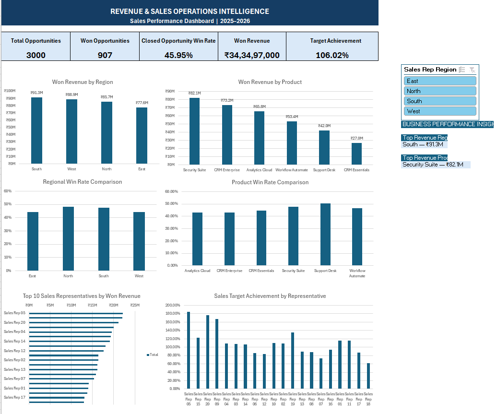
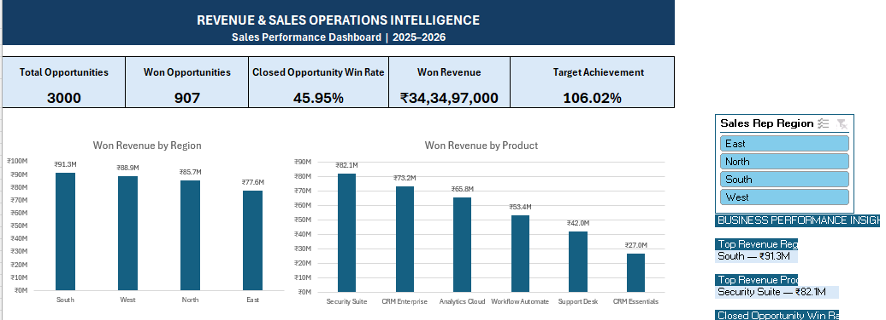
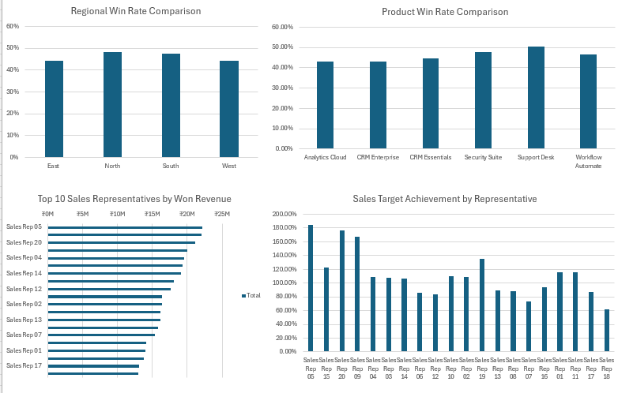

# Revenue & Sales Operations Intelligence

**Interactive Excel Sales Performance Dashboard | NexaCloud (Synthetic Case Study)**

## Project overview
This portfolio project demonstrates an end-to-end sales operations analytics workflow: generating and validating a synthetic CRM-style dataset, transforming it with Excel Power Query, analyzing performance using PivotTables and PivotCharts, and building an interactive dashboard for management reporting.

**Note:** NexaCloud is a fictional case study. All data and findings are simulated and do not represent a real company's results.

## Business problem
A sales operations team needs a consistent way to track pipeline outcomes, revenue contribution, regional and product performance, representative achievement, and progress against targets. The dashboard consolidates these metrics to help identify where performance is strong and where further investigation is warranted.

## Dataset
The project uses five synthetic CSV datasets:

| Dataset | Records | Purpose |
|---|---:|---|
| Customers | 500 | Customer-level attributes |
| Products | 6 | Product catalog |
| Sales representatives | 20 | Sales team reference data |
| Opportunities | 3,000 | Pipeline stage, deal values, and outcomes |
| Sales activities | 10,482 | Activity records associated with the sales process |

Opportunity stages in the generated dataset: **907 Won**, **1,067 Lost**, and **1,026 Open**.

## Tools and methods
- **Python:** synthetic data generation and validation scripts.
- **Excel Power Query:** data import, cleaning, and transformation.
- **Excel PivotTables / PivotCharts:** regional, product, and representative analysis.
- **Excel formulas:** KPI summaries and dashboard insights.
- **Excel slicer:** interactive filtering by sales representative region.
- **Git and GitHub:** version control and portfolio documentation.

## Dashboard KPIs
The all-region dashboard reports:

| Metric | Result |
|---|---:|
| Total opportunities | 3,000 |
| Won opportunities | 907 |
| Closed opportunity win rate | 45.95% |
| Won revenue | ₹34,34,97,000 |
| Target achievement | 106.02% |

**Win-rate definition:** Won opportunities divided by closed opportunities (Won + Lost), not by all opportunities. Values shown are from the synthetic dataset.

## Dashboard analysis
The dashboard includes:
1. Won revenue by region.
2. Won revenue by product.
3. Regional win-rate comparison.
4. Product win-rate comparison.
5. Top 10 sales representatives by won revenue.
6. Sales target achievement by representative.
7. Region slicer and dynamically linked business performance insights.

## Key findings
- **South** is the highest won-revenue region, at approximately **₹91.3 million**.
- **Security Suite** is the highest won-revenue product, at approximately **₹82.1 million**.
- **Closed opportunity win rate:** **45.95%**, suggesting scope to investigate losses and improve conversion.
- **Target achievement:** **106.02%** in the all-region view, indicating aggregate performance above the modeled target.

These are descriptive findings, not causal explanations. Further analysis would be needed to determine why regions, products, or representatives differ.

## Suggested business actions
- Investigate lost opportunities by region, product, and sales representative to identify recurring loss patterns.
- Review practices in higher-performing regions for potential replication, while accounting for differences in opportunity mix.
- Compare product win rates alongside won revenue to distinguish deal volume, conversion, and deal size effects.
- Monitor representative-level target achievement and investigate large deviations before making coaching or capacity decisions.

## Dashboard screenshots

### Complete dashboard overview

### KPIs, revenue, and business insights

### Win rate and sales representative performance

## How to explore
1. Download `excel_dashboard/NexaCloud_PowerQuery_Workbook.xlsx`.
2. Open the workbook in desktop Microsoft Excel.
3. Go to the **Sales_Dashboard** worksheet.
4. Use the **Sales Rep Region** slicer to explore regional results.
5. Review the KPI cards, PivotCharts, and business performance insights.

**Security:** Excel may warn about external data connections. Only enable or refresh connections after reviewing the workbook and confirming that the source paths are trusted and available on your computer. The dashboard can be inspected without enabling untrusted connections.

## Portfolio skills demonstrated
Business performance reporting · Sales operations analytics · KPI definition · Excel Power Query · PivotTables · PivotCharts · Interactive dashboards · Data validation · Business insights · Git/GitHub
